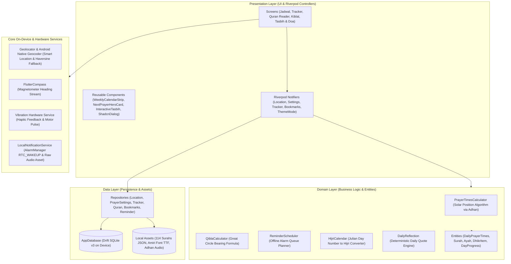
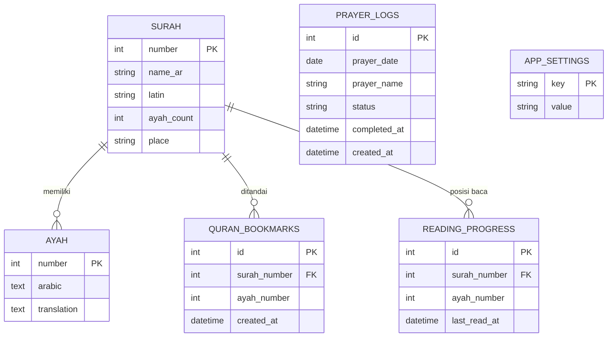

# Muslimin — Offline-First Islamic Daily Companion

<p align="center">
  
</p>

<p align="center">
  <strong>Aplikasi Utilitas Ibadah Muslim Harian 100% Offline-First (Jadwal Sholat Astronomis, Al-Qur'an Digital, Arah Kiblat, Tracker Sholat, Tasbih & Doa Harian)</strong>
</p>

<p align="center">
  <a href="https://github.com/sukr02k/muslimin/releases/latest">
    
  </a>
  
  
  
  
  
  
</p>

---

## Ringkasan Proyek (Overview)

**Muslimin** adalah aplikasi pendamping ibadah harian muslim yang dibangun dengan prinsip **100% Offline-First & Privacy-Focused**. Aplikasi ini dirancang tanpa pelacakan data analitik pengguna, tanpa akun/login, dan sepenuhnya bebas iklan komersial.

Seluruh data Al-Qur'an (114 surah, 6.236 ayat lengkap dengan terjemahan resmi Kemenag RI), algoritma hisab astronomis waktu sholat, pembacaan kompas sensor magnetometer, pencatatan tracker sholat di database lokal **Drift (Type-Safe SQLite)**, hingga penjadwalan alarm suara adhan berjalan murni di dalam perangkat pengguna tanpa bergantung pada koneksi internet atau server pihak ketiga.

---

## Arsitektur Aplikasi

Aplikasi mengimplementasikan arsitektur **Feature-First / Vertical Slice** dengan pemisahan lapisan yang tegas antara **Presentation (UI & Notifiers)**, **Domain Layer (Models & Logic)**, **Core On-Device Services**, dan **Data Layer (Drift SQLite)**:



---

## Entity-Relationship Diagram (Database SQLite Lokal)

Penyimpanan persisten pengguna dikelola secara lokal pada database file SQLite perangkat menggunakan ORM **Drift**. Teks Al-Qur'an statis dibundel sebagai aset lokal dan berelasi konseptual dengan tabel bookmark dan progress membaca:



---

## Fitur Utama

### 1. ⏱️ Jadwal Sholat & Waktu Matahari
- Perhitungan hisab posisi matahari astronomis (`adhan`) tanpa request server.
- Standar hisab Kementerian Agama Republik Indonesia (Subuh 20°, Isya 18°) serta opsi standar dunia (MWL, Mesir, Makkah, Karachi).
- Pilihan mazhab penentuan waktu Ashar (Syafi'i/Hanbali/Maliki 1x bayangan vs Hanafi 2x bayangan).
- Informasi waktu **Imsak** (10 menit sebelum Subuh), **Terbit (Syuruq)**, dan **Dhuha**.
- Deteksi nama wilayah administratif GPS secara otomatis via native geocoder OS dengan fallback formula Haversine ke 40+ koordinat kota Indonesia.
- Kartu suasana waktu sholat dinamis (fajar, siang, senja, malam) dan mutiara hadits/ayat harian yang berganti otomatis.
- **Zero-Scroll Hero Layout**: Seluruh 5 waktu sholat tampil utuh dalam satu layar tanpa terpotong.

### 2. 📿 Tracker Sholat Harian
- Pencatatan pelaksanaan sholat fardhu 5 waktu dengan status biner sederhana (*Sudah / Lewat*).
- Strip kalender mingguan interaktif untuk berpindah tanggal secara instan dengan indikator penyelesaian di bawah tanggal.
- Penghitung streak sholat beruntun dan rasio kepatuhan 7 hari terakhir.
- Haptic feedback motor getar perangkat saat menandai status sholat.

### 3. 📖 Al-Qur'an Digital 114 Surah
- Teks lengkap 114 surah (6.236 ayat) bersumber dari Tanzil & Kemenag RI, dibundel lokal di dalam aset aplikasi.
- Tipografi mushaf klasik menggunakan font resmi **Amiri Quran** (Regular & Bold) lengkap dengan ornamen nomor ayat khas mushaf Madinah (`۝`).
- Kop / Header pembuka surah bergaya mushaf klasik (informasi Makkiyyah/Madaniyyah & lafaz kaligrafi Basmalah).
- Pencarian surah cepat berdasarkan nama latin, nomor urut, atau aksara Arab.
- Pengatur ukuran huruf Arab real-time (20–38 pt) dengan penyimpanan preferensi lokal.
- Layar khusus **Ayat Tersimpan (Bookmark Hub)** dan penanda bacaan terakhir (*Reading Progress*).
- Fitur salin ayat dan terjemahan ke clipboard.

### 4. 🧭 Arah Kiblat (Kompas Interaktif)
- Perhitungan Great Circle Bearing dari koordinat perangkat ke Ka'bah (Makkah).
- Kompas visual real-time terhubung ke sensor magnetometer perangkat dengan arah mata angin Indonesia (`U`, `T`, `S`, `B`).
- Haptic feedback saat ponsel berada tepat searah dengan Ka'bah (toleransi ±3.5°).
- Petunjuk kalibrasi kompas angka delapan (∞) melalui dialog kustom.

### 5. 🤲 Tasbih Digital & Doa Harian
- Tombol tasbih digital dengan animasi spring tactile dan getaran motor fisik di setiap ketukan.
- Pola getaran ganda saat putaran dzikir mencapai target (33x atau 100x).
- Koleksi doa sehari-hari lengkap dengan teks Arab, transliterasi latin, terjemahan, dan rujukan sumber hadits/Al-Qur'an.
- Fitur salin doa ke clipboard.

### 6. 🔔 Pengingat Adhan Otomatis
- Penjadwalan alarm persis via `AlarmManager` Android (`RTC_WAKEUP`) tanpa backend.
- Lantunan suara adhan merdu dari berkas audio lokal (`res/raw/adhan.ogg`).
- Pengaturan per-sholat dan waktu pengingat fleksibel (Tepat Waktu, 5, 10, 15, atau 30 menit sebelumnya) via segmented chips sekali ketuk.

### 7. 🌙 OLED Dark Mode & Desain Terpusat
- Desain terinspirasi Shadcn (Slate + Emerald).
- Mode Gelap OLED murni (`#09090B`) yang ramah mata di malam hari dan hemat daya baterai layar AMOLED.
- Pilihan tema: Ikuti Sistem, Mode Terang, atau OLED Gelap.
- Navigasi aman dengan proteksi *Double-tap Back to Exit*.

---

## Struktur Direktori

```text
lib/
├── main.dart
└── src/
    ├── app/
    │   ├── app.dart                                # MaterialApp & ThemeMode Loader
    │   └── home_shell.dart                         # NavigationBar Shell & PopScope
    ├── core/
    │   ├── calendar/
    │   │   └── hijri_calendar.dart                 # Konverter Kalender Hijriah
    │   ├── config/
    │   │   └── app_config.dart
    │   ├── database/
    │   │   ├── app_database.dart                   # Schema Drift SQLite
    │   │   └── app_database.g.dart
    │   ├── prayer_name.dart                        # Enum 5 Waktu Sholat
    │   ├── providers.dart                          # Global Core Providers
    │   ├── settings/
    │   │   └── app_settings_repository.dart
    │   └── theme/
    │       ├── app_theme.dart                      # Design Tokens (Slate + Emerald)
    │       ├── shadcn_dialog.dart                  # Dialog Modal Kustom
    │       ├── shadcn_widgets.dart                 # Reusable Shadcn Card & Badge
    │       ├── theme_mode_controller.dart          # Light/Dark/System State
    │       └── weekly_calendar_strip.dart          # Horizontal Week Calendar Strip
    └── features/
        ├── adhan_reminder/
        │   ├── data/
        │   │   ├── local_notification_service.dart # AlarmManager & Audio Sound Binding
        │   │   └── reminder_settings_repository.dart
        │   ├── domain/
        │   │   ├── reminder_models.dart
        │   │   └── reminder_scheduler.dart         # Antrean Notifikasi Persis
        │   └── presentation/
        │       ├── reminder_controllers.dart
        │       └── reminder_settings_sheet.dart    # Sheet Pengaturan Adhan
        ├── dhikr_tasbih/
        │   ├── domain/
        │   │   └── dhikr_models.dart               # Dataset 7 Dzikir & 8 Doa Harian
        │   └── presentation/
        │       ├── dhikr_tasbih_screen.dart
        │       └── widgets/
        │           └── interactive_tasbih_button.dart # Tactile Spring Counter
        ├── prayer_times/
        │   ├── data/
        │   │   ├── cities.dart                     # Database Koordinat 40+ Kota RI
        │   │   ├── location_repository.dart        # Geocoder & Haversine Fallback
        │   │   └── prayer_times_settings_repository.dart
        │   ├── domain/
        │   │   ├── daily_prayer_times.dart         # Entities Sholat & Waktu Matahari
        │   │   ├── daily_reflection.dart           # Mesin Mutiara Harian
        │   │   ├── geo_location.dart
        │   │   ├── prayer_settings.dart
        │   │   └── prayer_times_calculator.dart    # Algoritma Astronomis Adhan
        │   └── presentation/
        │       ├── prayer_times_controllers.dart
        │       ├── prayer_times_screen.dart        # Zero-Scroll Hero Dashboard
        │       └── widgets/
        │           ├── modern_settings_sheet.dart  # Modal Pengaturan Terpadu
        │           └── next_prayer_hero_card.dart  # Kartu Suasana Waktu Sholat
        ├── prayer_tracker/
        │   ├── data/
        │   │   └── prayer_tracker_repository.dart
        │   ├── domain/
        │   │   ├── prayer_status.dart              # Status Biner (Sudah / Lewat)
        │   │   └── prayer_tracker_summary.dart     # Streak & Weekly Progress
        │   └── presentation/
        │       ├── prayer_tracker_controllers.dart
        │       └── prayer_tracker_screen.dart
        ├── qibla_finder/
        │   ├── domain/
        │   │   └── qibla_calculator.dart           # Formula Great Circle Bearing
        │   └── presentation/
        │       ├── qibla_controllers.dart          # Stream Sensor Magnetometer
        │       ├── qibla_finder_screen.dart
        │       └── widgets/
        │           └── qibla_compass_dial.dart     # CustomPainter Dial Kompas
        └── quran_reader/
            ├── data/
            │   ├── quran_bookmark_repository.dart
            │   ├── quran_repository.dart           # Local Asset Loader (114 Surah)
            │   └── reading_progress_repository.dart
            ├── domain/
            │   ├── quran_models.dart
            │   └── quran_parser.dart
            └── presentation/
                ├── quran_bookmarks_screen.dart     # Hub Ayat Tersimpan
                ├── quran_reader_controllers.dart   # Search, Font Size, Bookmarks
                ├── quran_reader_screen.dart        # Daftar 114 Surah & Search Bar
                └── surah_reader_screen.dart        # Pembaca Surah & Mushaf Banner
```

---

## Menjalankan Proyek

### Prasyarat
- [Flutter SDK](https://docs.flutter.dev/get-started/install)
- Android SDK (API level 34 atau 35)

### Menjalankan Mode Pengembangan
```bash
# Unduh seluruh dependensi paket
flutter pub get

# Jalankan pada perangkat Android yang terhubung
flutter run
```

### Menjalankan Pengujian Otomatis
```bash
# Analisis statis linter
flutter analyze

# Jalankan seluruh unit test
flutter test
```

---

## Lisensi & Kredensial Data

- **Teks Al-Qur'an Uthmani**: Tanzil Project.
- **Terjemahan Bahasa Indonesia**: Kementerian Agama Republik Indonesia (Kemenag RI).
- **Font Kaligrafi Arab**: [Amiri Font](https://github.com/aliftype/amiri) (Open Font License).
- **Perhitungan Waktu Sholat**: Formula algoritma hisab posisi matahari astronomis (`adhan` library).
